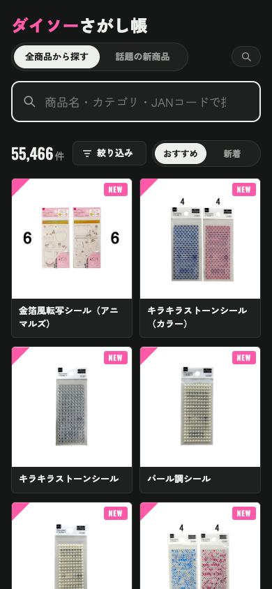
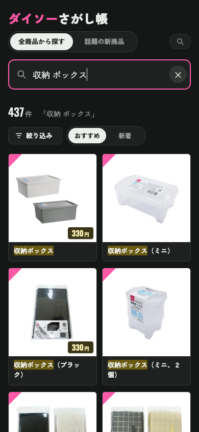

# ダイソーさがし帳

ダイソーネットストアの全商品（DAISO / Standard Products / THREEPPY）を一つの画面で探せるサイト。
ダイソー公式企業サイトの「話題の新商品」も見られる。個人で作った非公式のサイトです。

**公開中のサイト → https://daiso-sagashi.vercel.app**

<p>
  
  
</p>

## 使った技術

| 部分 | 技術 |
| --- | --- |
| データ集め | Python（標準ライブラリのみ） |
| 毎朝の自動更新 | GitHub Actions |
| 画面・検索 | HTML / CSS / JavaScript（ライブラリなし） |
| 公開 | Vercel |

約5.5万件の商品をブラウザの中だけで検索するので、サーバーを持たずに動きます。

## しくみ

- `scripts/build.py` が公式サイトから商品データを集めて `public/data/` に書き出す（標準ライブラリだけ）
- GitHub Actions（`.github/workflows/update.yml`）が毎朝 5:00（日本時間）に実行し、変わっていればコミット
- Vercel がコミットを受けて `public/` を公開し直す
- 検索はブラウザの中で動く（`public/search.js`）。サーバーはない

## 手元で動かす

```bash
python3 scripts/build.py
python3 -m http.server 8765 -d public
```

## 検索でできること

- 全角/半角、大文字/小文字、ひらがな/カタカナの違いは無視
- スペース区切りで AND、`-語` で除外、`"語"` で言い換えなしの完全一致
- よくある言い換え（スマホ⇔スマートフォン、タッパー⇔保存容器 など）は `search.js` の `SYNONYMS` に追加できる
- 数字 6 桁以上は JAN コードの前方一致
- 全部の語を含む商品がなければ一部一致、それもなければ似た表記で探し直す
